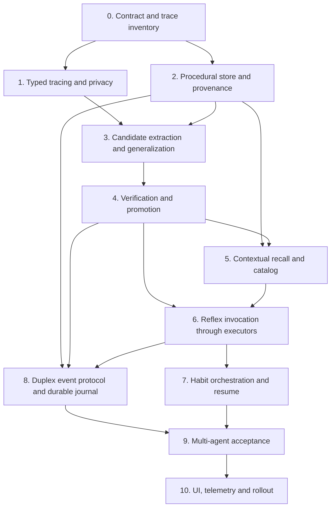

# Procedural Memory: implementation and integration plan

Status: **Planned — no executable procedural-memory runtime has been implemented.** Companion design: [PROCEDURAL_MEMORY.md](PROCEDURAL_MEMORY.md). Scope: Aive's four memory pillars (recollection, consolidation, reflexes, habits) and its agent-neutral duplex MCP transport.

## Principles and decisions to lock first

1. **Ownership:** The contextual memory layer captures and indexes experience, the new procedural sidecar stores versions and execution evidence, and the existing workflow engine/executor integrations remain the only task/action authority.
2. **Clerk governance:** Existing memory micro-agents may summarize/cluster traces but cannot evaluate truth, promote candidates, choose an implementation, grant authority, or directly run a procedure.
3. **Procedure identity:** A stable versioned ID plus immutable digest, independent of the remembered summary. No unpinned code invocation, and no live rewriting of active scripts.
4. **Safety defaults:** Capture is configurable; suggestions are opt-in, invocation requires explicit selection; automatic low-risk reflex activation is a later separately gated capability. Mutating steps always retain existing permission and approval requirements.
5. **Remote peers:** Full-duplex MCP provides symmetrical coordination and reports; not a remote shell, second task scheduler, source of truth, or permission system.
6. **Persistence:** Use a dedicated per-workflow `ProcedureStore` interface (in-memory test backend, durable SQLDelight-backed platform adapters). Do not add executable free text to `MemorySnapshot` or put large script bodies in general Settings.
7. **Compatibility:** Android, Desktop, JS and Wasm retain the common data model; platform-specific executor coverage is explicit rather than assumed.

## Dependency graph

The duplex protocol design can proceed in parallel with local reflex execution, but **must not ship remote invocation before the local authorization and journal layers pass**.

## Milestone 0 — contracts, instrumentation and baseline

**Code:** `docs/architecture/PROCEDURAL_MEMORY.md`, current memory/executor contracts, baseline benchmarks.

- Confirm the canonical set of structured execution events and their existing provenance. Inventory providers' actual tool-call receipts; do not claim visibility into provider-internal commands without an adapter.
- Identify live execution paths: `TaskExecutorIntegration.dispatch/reconcile`, script runners (Android JavaScript / GitHub Actions), test runner, repository operations, deployment, distributed execution, provider session artifacts.
- Define side-effect classes (`ReadOnly`, `Reversible`, `Mutating`, `Privileged`) and human-approval requirements delegated to existing workflow policies.
- Capture matched baseline provider input/output tokens, cost, latency, repeat-task success, retries and environmental context. Include cache-hit effects so savings are not falsely attributed to macros.
- Write explicit threat cases: prompt injection in captured output, poisoned remote procedures, hidden secrets, stale environment, revoked grants, retrying a non-idempotent action, duplicate delivery and broker restart.

**Gate:** Baseline and event fields reproducible; every executor either has structured receipts or is marked unsupported for learning.

## Milestone 1 — typed execution-trace collector

**Proposed files:** `shared/src/commonMain/kotlin/com/hereliesaz/geministrator/memory/procedural/ProcedureTrace.kt`, `ProceduralTraceObserver.kt`, `ProceduralTraceRedactor.kt`. Update `workflow/TaskExecutorIntegration.kt` and the approved concrete integrations.

- Record exact operation identity, typed inputs and result, tool version, platform capability, task/run/role and evidence IDs.
- Redact secrets/PII before persistence or model exposure; impose input/output byte limits and allowlisted metadata.
- Instrument dispatch and reconcile without changing executor return values, retries, approvals, idempotency or task status.
- Mark `Unknown` verification explicitly when only an artifact/agent message exists. Distinguish requested, accepted, executed, verified, and merely reported states.
- Feed contextual banking the *summary and provenance pointer* via existing episode session sources; avoid duplicate prompt injection.

**Tests:** Completed/failed/partial/cancelled execution; redaction; platform capability differences; replay dedup; no observer failure may change task status.

**Gate:** A captured structured trace can be reproduced deterministically in tests, and failures still enter contextual memory without becoming "successful macros."

## Milestone 2 — procedural library and lineage-aware storage

**Proposed files:** `ProcedureModels.kt`, `ProcedureStore.kt`, `InMemoryProcedureStore.kt`, `SqlProcedureStore.kt`, SQLDelight schema/query additions and platform adapters, `ProcedureProvenance.kt`, `ProcedureIndex.kt`.

- Versioned `ProcedureDefinition`, `ProcedureStep`, `ProcedureEvidence`, `ProcedureVersionEvent`, `ProcedureInvocation`, `ProcedureReference`.
- Canonical JSON serialization with schema version, integrity digests, bounded field lengths and strict import validation. Store script/recipe artifacts by immutable digest.
- Append-only candidate/validation/runs journal with atomic status transitions and optimistic revision/concurrency control.
- One writable library per workflow run, ancestor read through existing `MemoryBanks`/`MemoryLineage` rules; other same-project workflow libraries remain read-only.
- Link episode IDs both directions at the application layer, without creating model-writable execution edges. Handle clear, forget, raw purge, lineage merge, export/import and revoked source evidence.
- Provide stable migrations/backward compatibility across Android/Desktop/Web. No browser-local privilege assumptions.

**Tests:** Process restart; migration; lineage and cross-project isolation; forgetting only source; concurrent version approval; corrupted blobs; tampered digest; duplicate IDs.

**Gate:** Reload the same procedure/evidence after restart with identical digest and no unauthorized executable eligibility.

## Milestone 3 — candidate discovery and generalization

**Proposed files:** `ProcedureCandidateExtractor.kt`, `ProcedureParameterizer.kt`, `ProcedureCompatibility.kt`.

- Build simple reflex candidates from one structured successful operation, not transcript text alone.
- Generalize repeat candidates into declarative parameter schemas from multiple evidence-bearing traces; retain environment and precondition constraints.
- Detect provenance duplicates and failed variants; attach evidence without resolving contradictory outcomes inside the memory clerks.
- Keep procedure generation by normal agents separate from clerk indexing; proposals never automatically become callable.
- Refuse command templating that permits shell expansion, unbounded arbitrary paths, secret embedding or hidden tools.

**Tests:** Semantically similar but different flags; conflicting versions; malicious stdout containing instructions; untrusted agent proposals; repeated failures; opaque binary artifacts.

**Gate:** Candidate procedures are reproducible *as proposals*, not yet executable.

## Milestone 4 — verification, approval and promotion

**Proposed files:** `ProcedureValidator.kt`, `ProcedurePromotionPolicy.kt`, `ProcedureLifecycle.kt`, `ProcedureApprovalEvidence.kt`.

- Validate schema, digests, tool availability, parameter bounds, pre/postconditions, side-effect classification, provenance and current grants.
- Run available dry-run/sandbox/tests through the existing executors; record actual verification receipts and independent reviewer/approval decisions where required.
- Promote only a pinned immutable version. Failures quarantine; new improved bodies create candidate versions instead of editing an active one.
- Support explicit disable/rollback/expiration and environment-drift-triggered revalidation.

**Tests:** Forged "verified" claim, untrusted review, stale tool version, missing approval, unknown environment, actual test failure, revoked grant, compare-and-swap promotion race.

**Gate:** No candidate can become active by model confidence, frequency, or peer assertion alone.

## Milestone 5 — compact recall and agent affordances

**Proposed files:** `ProceduralRecallProvider.kt`, `ProcedureMatcher.kt`, `ProcedureCatalogRenderer.kt`; integrate with `memory/MemoryRuntimeBridge.kt`, `memory/MemoryLayerController.kt`, `workflow/ProviderBackedManagedSessionGateway.kt` and the Context Packer.

- Use the same objective/code symbols/cue scopes and provenance available to contextual GRIP; preserve contextual memory's Attention Deficit Dial.
- Rank only *eligible active* versions with comparable verification evidence and measured reuse data. Enforce cross-bank visibility before ranking.
- Return a short `proc:<id>@<version>` offer, precondition and input schema, not the full script or raw output.
- Limit candidate count and estimated context budget; retain ordinary contextual memory when it is more relevant.
- No implicit invocation on recall; the agent can decline or request full review.

**Tests:** Matching/false positives; unavailable executor; revoked or read-only version; budget cap; prompt cache behavior; contradiction in contextual memories; disabled memory.

**Gate:** Selecting no procedure leaves ordinary provider session behavior unchanged; measured prompt footprint stays under its configured cap.

## Milestone 6 — governed reflex execution

**Proposed files:** `ProcedureInvocationService.kt`, `ProcedureExecutorAdapter.kt`, `ProcedureRunJournal.kt`, `ProcedureArgumentBinder.kt`.

- Public API: `offerProcedures(context)`, `inspectProcedure(ref)`, `invokeProcedure(ref, params, taskContext)`, `getProcedureRun(id)`, `cancelProcedureRun(id)`.
- Resolve version/digest and structured arguments; recheck executor, role, environment and approval *at invocation*; log a durable idempotency key before side effects.
- Dispatch through existing `TaskExecutorIntegration` and `TaskExecutorContext` rather than adding an unrestricted shell/HTTP executor.
- Return structured success, failure, unknown or needs-human/agent decisions; produce ordinary `ArtifactRef` evidence and contextual episode.
- Enforce timeouts, retry policy and explicit no-replay rules for non-idempotent actions.

**Tests:** Success, no-op, failure, timeout, cancellation, denied approval, duplicate invocation, stale digest, runtime permission removal, failed journal write.

**Gate:** A single verified reflex can be invoked by reference with no re-expansion into model context, and no bypass of ordinary task permissions.

## Milestone 7 — habits, checkpoints and fallback

**Proposed files:** `ProcedureHabitPlanner.kt` (deterministic DAG runner), `ProcedureCheckpoint.kt`, `ProcedureRecoveryPolicy.kt`.

- Compose reflex IDs and typed executor operations into a bounded DAG; require explicit conditions, outputs, expected environment and finite retry limits.
- Persist step receipts before advancing; recover idempotent steps and return non-idempotent uncertain steps for human/agent judgment.
- Keep workflow coordinator authoritative; no hidden nested workflow launch or self-approval.
- On unexpected output/changed environment, hand the task back to an agent with summary, prior verified checkpoint, and unresolved evidence.
- Capture successful recovery as new experience but do not mutate active recipes.

**Tests:** Multi-step branches; crash at each checkpoint; parallel independent steps; cycle/depth/budget rejection; partial side effects; compensation; cancelled workflow.

**Gate:** Restart cannot silently repeat an irreversible action or mark unverified work complete.

## Milestone 8 — duplex MCP procedural exchange

**Proposed Aive files:** `duplex/ProcedureDuplexProtocol.kt`, `duplex/ProcedureDuplexInbox.kt`, `duplex/ProcedureDuplexOutbox.kt`, `duplex/ProcedureDuplexCoordinator.kt`; hook via existing `DuplexMcpPeer` and `DuplexTaskSessionAttachment`.
**Proposed MCPServed files:** `mcp/src/duplex-server.ts` / `duplex-server.test.ts` only if transport changes prove necessary; do not put procedure semantics inside a neutral broker.

- Add `aive.procedure.v1` typed payload routing before the existing chat-message bridge. Unknown schema/type fails closed without provider dispatch.
- Use `duplex_send` for short candidate/review/proposal/result messages, `duplex_receive` + ack after durable local ingest, SSE as a wakeup only.
- Log idempotency and correlation in Aive so broker restart/duplicate delivery cannot replay execution; add bounded send/backpressure/retry handling and cancellation separation.
- Use content-addressed refs for scripts larger than the broker's 32-KiB body limit, with authenticated, scope-limited fetch and digest verification. Start with metadata-only proposals; remote artifact transfer requires separate authorization.
- Allow either peer to independently ask the other for procedure applicability review, verify a trace, propose an alternative or report a failure. Receiving an invocation proposal never starts execution without local authorization.
- Keep pairing tokens private and scope/role associations host-owned. Explicitly deny inheriting MCPServed phone-control/ADB privileges.

**Tests:** Two simultaneous agents; independent reviews; opposite-side request/response; event correlation after request TTL; broker crash/restart; replay; partial failure; backpressure; oversized body; crossed credentials; malicious macro; unknown type; cancel; no remote auto-execution.

**Gate:** Aive ↔ MCPServed real cross-process acceptance passes with two distinct agents, both directions, restart/replay and local approval checks.

## Milestone 9 — observability, user controls and gradual rollout

**Proposed:** Memory screen four-pillar navigation and procedural library, procedure details/versions, traces/evidence, approval/disable/forget, learned reflex/habit suggestions, run history, token dashboard, explicit pairing state and reviewer feedback.

- Feature flags by platform and mode: `capture`, `suggest`, `invoke`, `duplex-share`, `low-risk-auto-invoke` (default off).
- Explicit safe defaults and import provenance; show executor availability and which steps require human approval.
- Metrics: verified reuse rate, failures, fallbacks, quaratined procedures, prompt input/output tokens, retrieval overhead, recovery cost, actual net token savings, run latency/cost, policy denials, remote replay counts.
- Evaluations compare same task/model/environment with and without procedural memory; success and authority preservation are **hard gates**. A token gain does not excuse safety, weaker verification, or hidden irreversible side effects.
- Platform matrix for Android (JS sandbox), Desktop, JS/Wasm, Actions, distributed nodes and MCP peers. Expose unsupported execution types as inspection-only.

**Gate:** User can inspect, disable, forget, export/import, and audit every proposed or active procedure and see measured savings.

## Proposed acceptance matrix

| Property | Acceptance criterion |
| --- | --- |
| Recall integrity | Prior contextual GRIP and consolidation tests pass unchanged; procedural offer is separate and small. |
| Evidence | No successful macro without structured step + independent verification receipt. |
| Authority | Attempted unapproved mutation fails; remote peer never inherits local grants. |
| Durable recovery | Restart recovers approved versions and run journal; duplicate events cannot repeat side effects. |
| Scope | Workflow bank writes local; ancestor and other-project access obey existing lineage/read-only rules. |
| Privacy/forget | Secrets never bank; erased source invalidates dependent executable variants. |
| Duplex | Both peers initiate simultaneously; events and acknowledgements work; broker outage does not fail local workflows. |
| Cost | Measured net tokens saved with equivalent outcomes; otherwise procedure is not ranked as a saving. |
| Fallback | Unknown preconditions/unsupported provider tools return control to agent. |
| Compatibility | Common/KMP tests and supported-platform integration checks pass before rollout. |

## Initial implementation batches

1. **Foundation PR:** typed models, sidecar store interface, journal schema and in-memory tests, no execution.
2. **Trace PR:** executor capture + privacy + linked contextual evidence, no promotion.
3. **Promotion PR:** candidate extraction and validation/approval state machine.
4. **Recall PR:** compact catalog via Memory Runtime Bridge and Context Packer.
5. **Reflex PR:** governed single-step invocation and token benchmark.
6. **Duplex PR:** application protocol, typed routing, durable receipts, adversarial and cross-process tests.
7. **Habit PR:** bounded DAG execution, crash recovery, fallback.
8. **Product PR:** four-pillar UI, control surfaces, telemetry and measured rollout.

Each batch is independently shippable behind flags, is accompanied by test evidence, and should not turn on a later capability until its own gate passes.

## Repository and verification hooks

Current source boundaries to edit:

- `shared/src/commonMain/kotlin/com/hereliesaz/geministrator/memory/MemorySessionObserver.kt`
- `shared/src/commonMain/kotlin/com/hereliesaz/geministrator/memory/MemoryLayerController.kt`
- `shared/src/commonMain/kotlin/com/hereliesaz/geministrator/memory/MemoryRuntimeBridge.kt`
- `shared/src/commonMain/kotlin/com/hereliesaz/geministrator/memory/MemoryBanks.kt`
- `shared/src/commonMain/kotlin/com/hereliesaz/geministrator/memory/SqlMemoryStore.kt` (or separate procedure SQLDelight store)
- `shared/src/commonMain/kotlin/com/hereliesaz/geministrator/workflow/TaskExecutorIntegration.kt`
- `shared/src/commonMain/kotlin/com/hereliesaz/geministrator/workflow/ProviderBackedManagedSessionGateway.kt`
- `shared/src/commonMain/kotlin/com/hereliesaz/geministrator/duplex/DuplexMcpPeer.kt`
- `shared/src/commonMain/kotlin/com/hereliesaz/geministrator/duplex/DuplexTaskSessionAttachment.kt`
- `androidApp/src/main/kotlin/com/hereliesaz/aive/AndroidJavaScriptExecutorIntegration.kt`
- `shared/src/commonMain/kotlin/com/hereliesaz/geministrator/workflow/GitHubActionsExecutorIntegration.kt`
- `shared/src/commonTest/kotlin/com/hereliesaz/geministrator/memory/` and `.../duplex/`
- `mcp/src/duplex-server.test.ts` in HereLiesAz/MCPserved.

Focused test targets should be discovered from the current Gradle test task listing; `./gradlew :shared:desktopTest` is the existing KMP desktop test convention. MCPServed currently documents `cd mcp && npm test`. Do not claim verification without executing tests or inspecting completed CI evidence.

## Deferred design decisions (resolved before implementation, not delegated to clerks)

- Exact persistence layout for immutable scripts/content blobs across KMP platforms and exported `.ive` bundles.
- First supported executor set and whether mutating reflexes remain permanently manual.
- Definition of objective success from acceptance criteria vs explicit reviewer attestation.
- Any cross-device artifact fetch/signature/attestation protocol beyond metadata-only MCP.
- Local eligibility ranking formula, benchmark target thresholds and retention periods.
